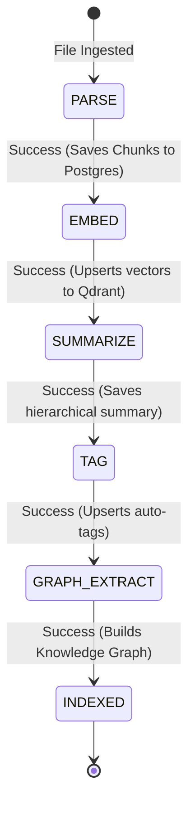

# KnowledgeOS: Full-Stack Engineering & System Architecture Interview Guide

This guide compiles the technical decisions, architecture patterns, core feature implementations, and high-frequency technical interview questions for **KnowledgeOS**.

---

## 🏗️ 1. Technical Architecture & Monorepo Structure

KnowledgeOS is designed as a polyglot distributed monorepo comprising three independent services communicating via REST, SSE, and background queues, backed by four purpose-specific data stores.

### Monorepo Layout
* **Gateway API**: [apps/backend](file:///k:/Projects/KnowledgeOS/knowledgeos/apps/backend) (Node.js + Express.js + TypeScript)
* **ML Inference Server**: [apps/ml-service](file:///k:/Projects/KnowledgeOS/knowledgeos/apps/ml-service) (FastAPI + Python 3 + PyTorch)
* **Web Client**: [apps/frontend](file:///k:/Projects/KnowledgeOS/knowledgeos/apps/frontend) (Vite 6 + React 18 + Tailwind CSS 4)
* **Shared Typings**: [packages/shared-types](file:///k:/Projects/KnowledgeOS/knowledgeos/packages/shared-types) (TypeScript interface boundaries)
* **Deployment/Docker Orchestration**: [infra/](file:///k:/Projects/KnowledgeOS/knowledgeos/infra)

---

## 💾 2. Polyglot Storage Architecture

KnowledgeOS uses a **polyglot database strategy** where each database is chosen to match its specific data access patterns:

```
  ┌──────────────────┐      ┌───────────────┐      ┌───────────────┐      ┌──────────────┐
  │  PostgreSQL      │      │  Redis        │      │  Qdrant       │      │  Neo4j       │
  │  (Relational)    │      │  (In-Memory)  │      │  (Vector DB)  │      │  (Graph DB)  │
  ├──────────────────┤      ├───────────────┤      ├───────────────┤      ├──────────────┤
  │ User Auth, Doc   │      │ Bull Queues,  │      │ 384-dim Dense │      │ Named Entity │
  │ Metadata, Chunks,│      │ Job States,   │      │ Document      │      │ & Document   │
  │ Revision Cards   │      │ Cache Store   │      │ Embeddings    │      │ Concept Links│
  └──────────────────┘      └───────────────┘      └───────────────┘      └──────────────┘
```                          

1. **PostgreSQL (relational metadata, schema managed by Prisma):** Stores transactional metadata including Users, Document info, text Chunk mappings, Spaced Repetition/Revision items, Knowledge Gaps, and Workspace Spaces.
2. **Redis (Bull Queue):** Acts as the asynchronous job queue broker, tracking processing stage states, logs, and backoff attempts.
3. **Qdrant (vector DB):** Provides ultra-fast cosine similarity lookups over dense vector embeddings. Stored under user-isolated namespaces.
4. **Neo4j (graph database):** Maps extracted entity-to-document and concept-to-concept linkages, allowing structural relationship queries.

---

## ⚡ 3. Core Modules & Production Pipelines

### 🔄 A. The 5-Stage Document Processing Pipeline

The ingestion pipeline is architected around **asynchronous, stage-isolated message queues** built on **Bull** and backed by **Redis**.



#### Detailed Breakdown of the Ingestion Stages:
1. **`PARSE` Stage** ([jobWorkers.ts](file:///k:/Projects/KnowledgeOS/knowledgeos/apps/backend/src/queues/jobWorkers.ts#L81-L151)):
   * Downloads the file from Google Drive via Google APIs or temp local uploads.
   * Runs mime-type specific parsing (e.g. `pdf-parse` for binary documents, native string reads for text/markdown).
   * Segments raw text into a sliding window of overlapping chunks of maximum $512$ tokens (with a $50$-token overlap to maintain context across boundary sentences).
   * Chunks are bulk-upserted into the PostgreSQL `Chunk` table.
2. **`EMBED` Stage** ([jobWorkers.ts](file:///k:/Projects/KnowledgeOS/knowledgeos/apps/backend/src/queues/jobWorkers.ts#L153-L200)):
   * Reads raw chunk contents from PostgreSQL.
   * Sends batches to the FastAPI ML service to generate $384$-dimensional dense vector embeddings using the `all-MiniLM-L6-v2` SentenceTransformer model.
   * Vectors are upserted into **Qdrant** collections namespaced by `userId`. Points are tagged with payload metadata containing `documentId` and `chunkId` to link them back to Postgres.
3. **`SUMMARIZE` Stage** ([jobWorkers.ts](file:///k:/Projects/KnowledgeOS/knowledgeos/apps/backend/src/queues/jobWorkers.ts#L202-L260)):
   * Evaluates text length. If the document exceeds the summarizer’s 1024-token context window, it runs a **hierarchical summarization algorithm**:
     * Splits text into blocks of 1024 tokens.
     * Generates a mini-summary for each block using `distilbart-cnn-12-6`.
     * Concatenates block summaries and compresses them down to a final cohesive summary ($50\text{–}150$ tokens).
4. **`TAG` Stage** ([jobWorkers.ts](file:///k:/Projects/KnowledgeOS/knowledgeos/apps/backend/src/queues/jobWorkers.ts#L262-L318)):
   * Embeds the document title concatenated with its summary.
   * Computes cosine similarity scores against pre-computed embeddings of 22 predefined taxonomy subjects.
   * Automatically assigns categories that exceed a similarity threshold of $0.35$.
5. **`GRAPH_EXTRACT` Stage** ([jobWorkers.ts](file:///k:/Projects/KnowledgeOS/knowledgeos/apps/backend/src/queues/jobWorkers.ts#L320-L400)):
   * Uses spaCy’s Named Entity Recognition (NER) model (`en_core_web_trf` falling back to `en_core_web_sm`) together with custom regex pattern rules.
   * Extracts concepts, technologies, people, and locations.
   * Upserts extracted entities as `KnowledgeNode` objects in PostgreSQL and relationships inside **Neo4j** (mapping co-occurrences and tag linkages).

#### 🛡️ Failure Isolation & Fault Tolerance
* **The Problem**: Traditional pipelines fail entirely if an downstream API (like tagging or entity extraction) goes down, requiring expensive re-parsing of raw files.
* **The Solution**: By splitting the pipeline into 5 decoupled Bull queues, each stage has custom retry rules (`attempts: 3`, exponential backoffs). State is persisted in PostgreSQL (`ProcessingJob` status tracking). If stage 4 (`TAG`) fails, the job can be retried starting exactly from stage 4 without re-downloading or re-parsing the original document.

---

### 🔍 B. Hybrid Semantic Search & Cross-Encoder Re-ranking
Standard vector search can surface semantic matches that lack exact keyword matches (or vice versa). KnowledgeOS implements a **hybrid retrieval and re-ranking pipeline** in [search.py](file:///k:/Projects/KnowledgeOS/knowledgeos/apps/ml-service/routers/search.py):

```
 User Search Query 
       │
       ├───► Dense Vector Search (Qdrant) ──┐
       │                                    ├──► Merged Candidate Map (Max Top-50)
       └───► PostgreSQL Full-Text (BM25) ───┘
                                                │
                                                ▼
                                    Cross-Encoder Re-ranker
                                   (ms-marco-MiniLM-L-6-v2)
                                                │
                                                ▼
                                        Score Fusion 
                        (40% BM25 + 30% Vector + 30% Cross-Encoder)
```

1. **Candidate Retrieval**: Pools up to 50 candidates by combining dense vector results from Qdrant and relational Full-Text Search (FTS/BM25) from PostgreSQL.
2. **Neural Re-ranking**: Passes candidates through a **Cross-Encoder Model** (`ms-marco-MiniLM-L-6-v2`), evaluating query-chunk pairs together to capture deep logical relevance.
3. **Normalized Score Fusion**: 
   * normalizes BM25 scores relative to the max in the candidate set.
   * Maps Cross-Encoder logits to $[0, 1]$ using a sigmoid scaling function.
   * Fuses scores:
     $$\text{Final Score} = 0.40 \times \text{BM25} + 0.30 \times \text{Vector} + 0.30 \times \text{CrossEncoder}$$
   * Sorts the results, generating granular explanation percentages for the UI (Semantic match vs. Keyword match vs. Entity overlap).

---

### 💬 C. SSE Streaming Q&A & Citation System
Streams responses for Q&A in real-time, grounded directly in relevant document chunks.
* **SSE Pipeline** ([searchRoutes.ts](file:///k:/Projects/KnowledgeOS/knowledgeos/apps/backend/src/routes/searchRoutes.ts#L254)): The backend sets standard Server-Sent Events headers, queries the ML service RAG pipeline, and pipes the incoming HTTP chunk stream directly to the client.
* **Prompt Grounding**: The ML service formats retrieved chunks with `[Source N]` headers in the system prompt. Gemini is instructed to write responses using inline citations (`[Source N]`).
* **Citations Payload**: Once the token stream completes, the final SSE chunk delivers a structured array containing source titles, snippets, and page numbers, which the frontend displays as interactive citation cards.

---

### 🧠 D. Spaced Repetition (SuperMemo-2 Scheduler)
Provides active recall quizzing powered by the **SuperMemo-2 (SM-2) algorithm** in [revisionRoutes.ts](file:///k:/Projects/KnowledgeOS/knowledgeos/apps/backend/src/routes/revisionRoutes.ts#L110-L147):
* **Generative Quizzing**: The system extracts document chunks and uses LLM prompting to construct revision flashcards mapping to specific categories (`QA`, `DEFINITION`, `FILL_BLANK`).
* **SM-2 State Machine**:
  * Calculates `nextReviewAt` based on user-supplied quality grades $0$ to $5$ ($0$ = total blackout, $3$ = correct with difficulty, $5$ = perfect).
  * If quality grade is $< 3$ (failure):
    * Resets repetition count to $0$ and schedules the next review in $1$ day.
  * If quality grade is $\ge 3$ (success):
    * Repetition $0$: Interval is $1$ day.
    * Repetition $1$: Interval is $6$ days.
    * Repetition $2+$: $\text{Interval} = \text{Previous Interval} \times \text{Ease Factor}$.
  * **Ease Factor (EF) Adjustment**:
    $$EF_{\text{new}} = EF_{\text{old}} + (0.1 - (5 - q) \times (0.08 + (5 - q) \times 0.02))$$
    *Lower limit of $EF$ is strictly set to $1.3$ to prevent cards from getting locked in "ease hell".*

---

### 🕸️ E. Interactive Knowledge Graph (Physics Render Loop)
Visualizes relationships between documents and extracted concept nodes using a custom force-directed engine in [frontend](file:///k:/Projects/KnowledgeOS/knowledgeos/apps/frontend/src):
* **Data Layer**: Graph nodes are composed of documents (type `OTHER`) and entities (type `CONCEPT`, `PERSON`, `TECHNOLOGY`). Edges are built when documents share a taxonomy tag (`SHARED_TAG`) or when a document mentions a concept (`CONCEPT_LINK`).
* **Forces Pipeline**: Runs a simulation using a `requestAnimationFrame` loop:
  1. **Coulomb's Law (Repulsion)**: Pushes nodes away from each other to prevent overlap.
  2. **Hooke's Law (Tension/Attraction)**: Pulls connected nodes together.
  3. **Friction/Damping**: Damps velocities to allow the simulation to settle.

---

### 📊 F. Educational Analytics & Knowledge Gaps Engine
Analyzes user activity to identify learning gaps and struggles:
* **Analytics Aggregation** ([knowledgeAnalyzer.ts](file:///k:/Projects/KnowledgeOS/knowledgeos/apps/backend/src/services/knowledgeAnalyzer.ts)): Gathers search history logs, unvisited documents, struggling flashcard topics (low ease factors, high failure counts), and recent chat conversations.
* **LLM Engine**: Prompts Gemini with this activity profile. The model returns a structured JSON listing the user's strong areas and specific "Knowledge Gaps" along with confidence levels.
* **Actionable Syllabus**: Feeds identified gaps into the **AI Mentor** ([mentorRoutes.ts](file:///k:/Projects/KnowledgeOS/knowledgeos/apps/backend/src/routes/mentorRoutes.ts)), which constructs a custom learning syllabus, adaptive quizzes, and grades student essay assignments using semantic checks.

---

## 🙋 4. Expected Interview Questions & Answers

### Q1: Why separate the ML Inference Server from the Express API Gateway? Why not run everything in a single Node/Python service?
**Answer:**
1. **Resource Profiles**: The ML service is heavily CPU/GPU-bound (running PyTorch models, sentence transformers, spaCy parsing). Express is network-bound (handling I/O, WebSockets, database reads, API routing). Separating them prevents blocking Express’s event loop during expensive matrix calculations.
2. **Runtime Environments**: Python has the native ecosystem for ML libraries (PyTorch, HuggingFace transformers, spaCy). TypeScript is ideal for rapid API routing, database schema migrations, and handling background worker configurations.
3. **Scaling**: Under heavy load, we can scale the FastAPI service independently (e.g. running it on a GPU-enabled node) while running multiple lightweight Express gateway instances to manage client requests.

---

### Q2: How did you implement reliability and prevent data loss in the ingestion queues (Bull/Redis)?
**Answer:**
1. **State Persistence**: The status of every ingestion stage is tracked in a PostgreSQL `ProcessingJob` table.
2. **Unique Job IDs**: We enforce deterministic job IDs (`parse-${documentId}`, `embed-${documentId}`) in `forceAddToQueue`. This prevents queue pollution and duplicate job execution.
3. **Idempotence**: Each stage is idempotent. For instance, the `EMBED` stage deletes old embeddings for that document before inserting new ones. If a worker crashes and retries, it won't duplicate vectors in Qdrant or chunks in Postgres.
4. **Exponential Backoff**: We configure queues with exponential backoff delays (e.g., delay of 5000ms, doubling on subsequent failures). This prevents hammering downstream services if they experience temporary outages.

---

### Q3: Explain why you chose to combine Dense Vector Search and BM25 (FTS). Why not just use Vector Search alone?
**Answer:**
* **Dense Vector Search** is great at capturing semantic meaning (e.g., matching "machine learning" with "neural networks" even if the exact keywords are missing). However, it struggles with:
  1. **Exact Matches**: Searching for specific identifiers, version numbers (e.g. "Vite 6"), or unique code tokens.
  2. **Short, Out-of-Vocabulary Terms**: Brand names or specialized abbreviations that weren't represented in the embedding model's training set.
* **BM25 (PostgreSQL FTS)** excels at exact term matching.
* By **pooling candidates from both** (up to 50 candidates) and feeding them to a **Cross-Encoder model**, we get the best of both worlds. The Cross-Encoder reviews query and document chunks together, determining context-specific relevance that simple vector cosine distance often misses.

---

### Q4: How does the Cross-Encoder re-ranker work, and how is it scored compared to the initial vector search?
**Answer:**
* During initial vector search, the query and document chunks are embedded **independently** (Bi-Encoder architecture), and their similarity is calculated using cosine distance. This is fast but doesn't capture deep interactions between query terms and text context.
* The **Cross-Encoder** (`ms-marco-MiniLM-L-6-v2`) takes the query and chunk text **together** as a single input pair and applies self-attention across all tokens. This yields a much higher quality relevance score.
* Since Cross-Encoder output consists of raw logits, we scale them into a $[0, 1]$ probability range using a Sigmoid function:
  $$ce\_norm = \frac{1}{1 + e^{-logit}}$$
* The final rank combines FTS keyword match, semantic cosine distance, and the re-ranker score:
  $$\text{Final Score} = 0.40 \times b\_score + 0.30 \times v\_score + 0.30 \times ce\_norm$$

---

### Q5: How do you handle Server-Sent Events (SSE) streaming connections through a gateway proxy, and what fails if you don't configure them correctly?
**Answer:**
* SSE streams need to remain open without buffering. If intermediate proxies (like Nginx, Cloudflare, or local gateways) buffer responses, the client won't receive streaming tokens in real-time. Instead, the proxy will wait until the connection closes to send the entire chunk in one go.
* To prevent this, KnowledgeOS configures explicit response headers:
  * `Content-Type: text/event-stream`
  * `Cache-Control: no-cache`
  * `Connection: keep-alive`
  * `X-Accel-Buffering: no` (Crucial for Nginx/reverse proxies to disable response buffering).
* On the backend, we use `res.flushHeaders()` to force headers down the wire immediately, ensuring subsequent tokens stream to the client without delays.

---

### Q6: If your database grows to millions of documents, how does the Qdrant vector store scale?
**Answer:**
1. **User Namespacing**: In KnowledgeOS, collections are namespaced by user ID. This partitions vector queries so a user only searches their own document space, avoiding searches across the entire database.
2. **Filtered Search**: We construct filter conditions inside Qdrant (e.g. matching `documentId` or `userId` in payloads) which Qdrant processes using HNSW (Hierarchical Navigable Small World) index filters, skipping irrelevant vectors early.
3. **Quantization**: If memory usage increases, we can enable scalar quantization in Qdrant. This compresses $32$-bit float vector values into $8$-bit integers, reducing memory footprint by up to 4x with minimal impact on retrieval recall.

---

### Q7: How does the AI Mentor essay assignment grading work? How do you prevent LLM grade inflation or hallucinations?
**Answer:**
* Grading is handled in [mentorRoutes.ts](file:///k:/Projects/KnowledgeOS/knowledgeos/apps/backend/src/routes/mentorRoutes.ts#L391-L408).
* To prevent grade inflation, the prompt establishes a strict rubric:
  1. The LLM must output structured JSON containing `score` (0.0 to 1.0), `feedback`, and `weakAreas`.
  2. The prompt instructs the LLM to search for evidence of understanding for specific subtopic mechanics.
  3. We parse the score and save the review history. If the score falls below a threshold (e.g., 70%), we dynamically generate a `KnowledgeGap` in PostgreSQL. This flags the topic for review and incorporates it into the user's personalized revision plan.
